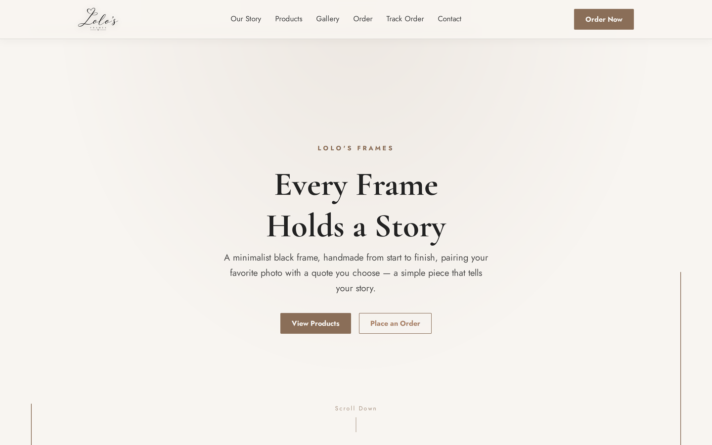
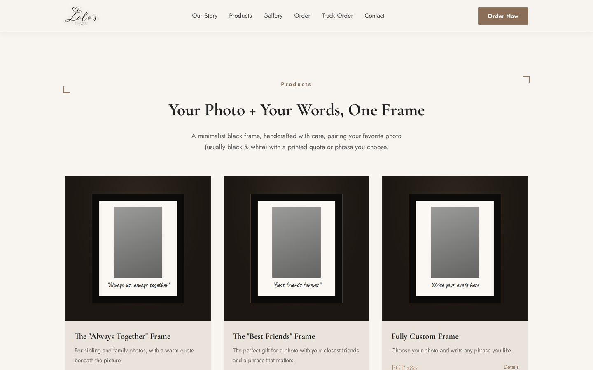
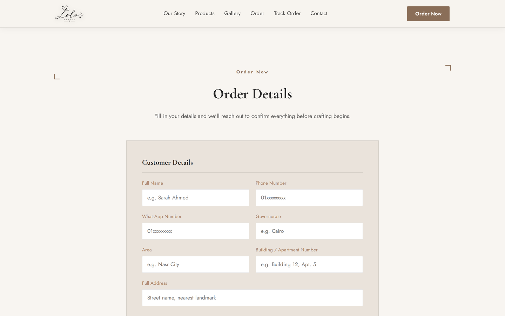
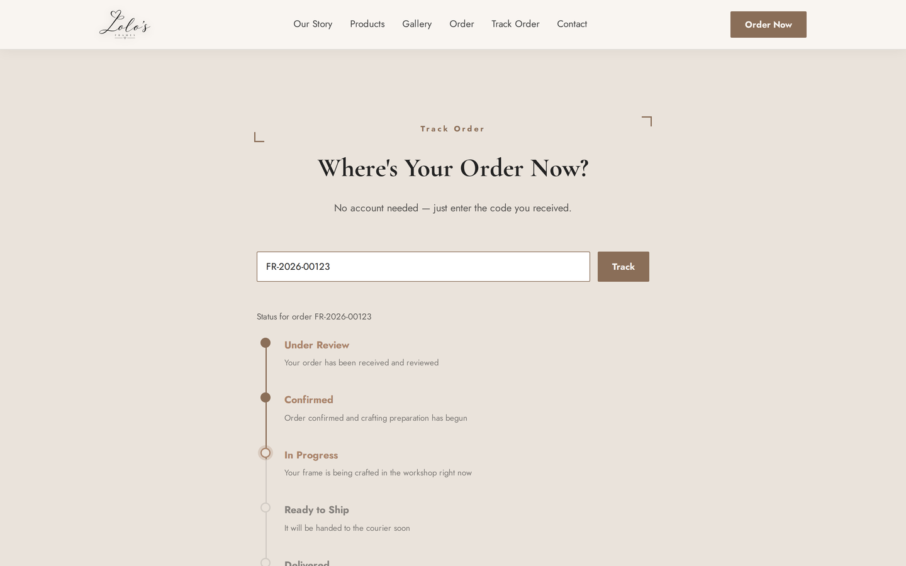
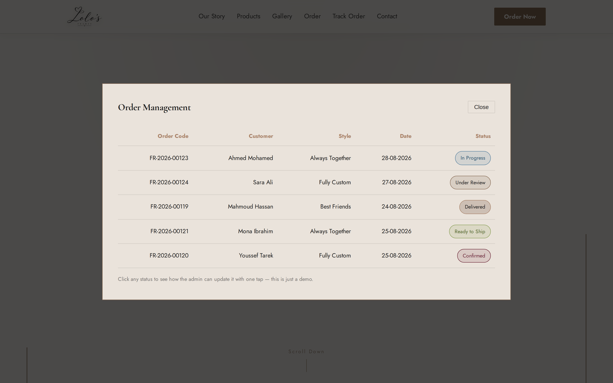
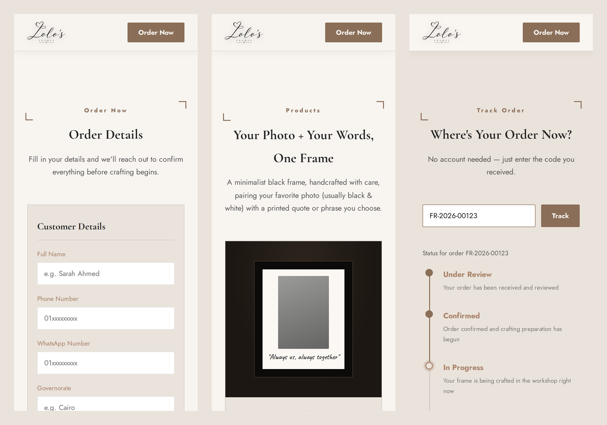
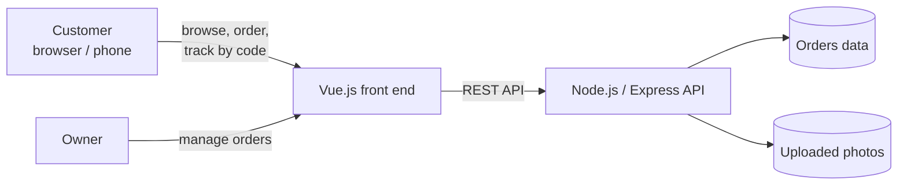

<h1 align="center">Lolo's Frames</h1>

<i>Framing memories, beautifully.</i>

  Marketing site + custom-order store for a handmade picture-frame brand

  
  
  
  

> **This repository is a project showcase.** The source code is private. It documents the product, the main flows and the design, with screenshots from the UI.

## The problem

Lolo's Frames sells handmade minimalist frames that combine a customer's photo with a printed quote. Every order is personalised (photos, size, colour, quote and delivery details), so the order process has to collect all of that cleanly and keep the customer informed until the frame arrives.

The goal is one place where a customer can **discover the brand, place a fully customised order with photos, and follow it until delivery**, without creating an account, while the owner manages every order from a simple admin view.

## Features

**For customers**
- **Brand & product showcase:** story, product styles with prices, and a gallery of finished frames
- **Custom-order flow:** frame style, size (15×10 / 21×15 cm), colour (black / white), up to **5 photo uploads**, the quote to print and extra notes
- **Delivery details form:** name, phone, WhatsApp, governorate, area, address and building/apartment
- **Instant tracking code** (e.g. `FR-2026-00123`) shown when the order is placed
- **Order tracking without registration:** enter the code and see a step-by-step timeline
- **Terms, privacy and delivery & returns pages** linked from the order form
- **Responsive:** works on phones, tablets and desktop
- **Bilingual:** English and Arabic versions

**For the owner (admin)**
- Orders table with code, customer, style, date and status
- One-tap status updates that are reflected on the customer's tracking page

## Screenshots

| Products | Order form |
|---|---|
|  |  |

| Order tracking | Admin: order management |
|---|---|
|  |  |

**Mobile**

Customer names and order codes in the screenshots are demo data.

## Order lifecycle

Every order moves through five statuses. The admin changes the status and the customer's tracking timeline updates.

```mermaid
stateDiagram-v2
    direction LR
    [*] --> UnderReview: Customer submits order<br/>tracking code generated
    UnderReview --> Confirmed: Owner confirms details<br/>with the customer
    Confirmed --> InProgress: Frame is being crafted
    InProgress --> ReadyToShip: Handed to courier soon
    ReadyToShip --> Delivered
    Delivered --> [*]

    UnderReview: Under Review
    InProgress: In Progress
    ReadyToShip: Ready to Ship
```

## How it works

## Design decisions

- **Tracking by code instead of accounts.** A frame is often a one-off purchase or a gift, so registration would only add friction. The order code shown after checkout is all the customer needs to follow the order, and the tracking page shows status only, never personal details.
- **Delivery fields that match local addresses.** Governorate, area, building/apartment and a separate WhatsApp number make confirmation and courier hand-over straightforward.
- **Up to 5 photos per order,** with clear upload guidance, because photo quality directly affects the printed result.
- **Only the data the order needs.** Photos and personal details are used only to make and deliver the order, as stated in the privacy policy shown next to the order form.
- **Brand-first UI.** The palette (Ivory `#F8F5F1`, Warm Beige `#EAE3DB`, Taupe `#B8AEA4`, Soft Brown `#8A6E58`, Charcoal `#222222`) and the Cormorant Garamond headings come from the brand guidelines, so the site feels like the physical product.

## Tech stack

| Layer | Technology |
|---|---|
| Front end | Vue.js, HTML5, CSS3 |
| Back end | Node.js, Express (REST API) |
| Uploads | Multi-photo upload per order |
| Design | Brand palette and typography (Cormorant Garamond, Jost) |

## Status

In active development. The UI shown here is the approved design; the Express back end, admin workflow and Arabic version are being built on top of it.

---

Built by [Karim Ahmed Hamdy](https://github.com/karim-ahmed66) · [LinkedIn](https://www.linkedin.com/in/karim-ahmed-hamdy)
